# commitboard-animations

Animated SVGs made from your GitHub contribution graph, ready to drop into a profile README.
Zero dependencies, just Node 18+. The SVGs use SMIL, so they keep animating when GitHub
serves them through an `` tag.

The previews below use generated sample data. Yours will show your real year.

| | |
|---|---|
| **gravity**: your year drops in column by column, settles, then falls through the floor | 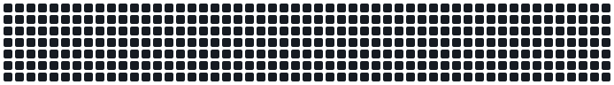 |
| **wave**: a diagonal swell of light rolls across your board | 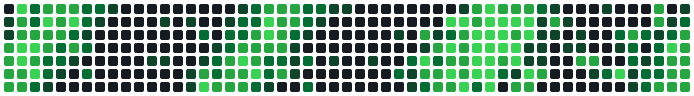 |
| **life**: Conway's Game of Life seeded with your commits, then wiped back to reality | 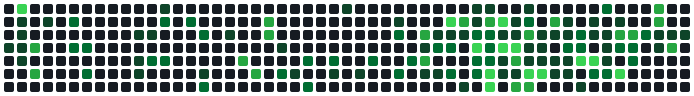 |
| **scanner**: a bouncing beam lights up your history as it passes | 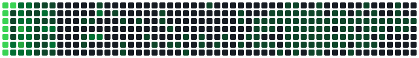 |
| **marquee**: your own message scrolls across a dimmed copy of your board | 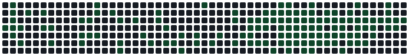 |
| **ripple**: raindrops land and send rings outward | 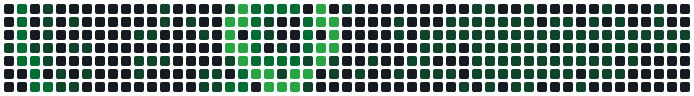 |
| **matrix**: falling streams with bright heads and fading tails | 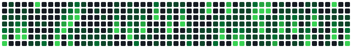 |
| **fireworks**: rockets climb the board and burst into sparks | 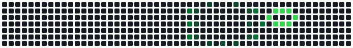 |
| **equalizer**: every week becomes a bouncing bar with hanging peaks | 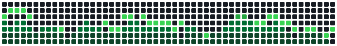 |
| **pulse**: a heart-monitor trace sweeps across the board | 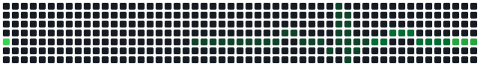 |
| **oven**: flames rise from the bottom of the board, and your busiest weeks burn hottest | 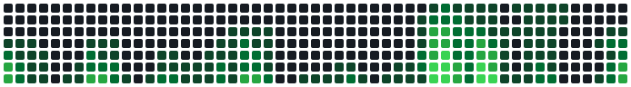 |
| **sort**: each week collapses into a bar, the bars sort themselves, then it all rewinds |  |
| **decrypt**: static noise locks into your real board week by week, then scrambles again | 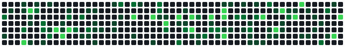 |
| **plasma**: old-school demo plasma drawn as glowing contour bands | 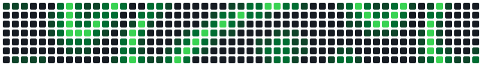 |
| **sand**: three spouts pour sand into heaps, then the floor opens and it drains away | 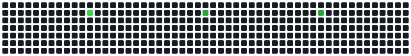 |
| **starfield**: three layers of stars drift past at different speeds | 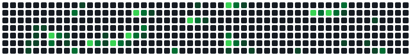 |

Every animation comes in `-light` and `-dark` variants using GitHub's own greens.

## Use it on your profile

1. Merge this into `main`. The workflow in `.github/workflows/commitboard.yml` runs on every
   push to `main`, once a day, and on demand from the Actions tab. It fetches your contribution
   graph and publishes the SVGs to an `output` branch.
2. Embed one in your profile README, swapping in your name and animation:

   ```md
   
   ```

   To switch between light and dark with the viewer's theme, use a `<picture>` tag instead.
   It works on github.com, but the GitHub mobile app shows it as a broken image:

   ```html
   <picture>
     <source media="(prefers-color-scheme: dark)"
             srcset="https://raw.githubusercontent.com/USER/commitboard-animations/output/life-dark.svg">
     
   </picture>
   ```

### Options (repository settings → Secrets and variables → Actions)

| Name | Kind | What it does |
|---|---|---|
| `MARQUEE_TEXT` | variable | Message for the marquee animation (default `COMMIT EARLY, COMMIT OFTEN ♥`) |
| `COMMITBOARD_USER` | variable | Animate someone other than the repo owner |
| `COMMITBOARD_TOKEN` | secret | Personal access token (`read:user`) so private contributions count |

## Run it locally

```sh
node src/cli.js --user <your-login> --out dist      # real data (set GITHUB_TOKEN to use the API)
node src/cli.js --sample --out examples             # sample data
node src/cli.js --sample --only marquee --text "HELLO WORLD!"
```

Open `dist/index.html` to preview everything. Run `node src/cli.js --help` for all flags.

## Make your own

Each animation in `src/animations.js` is a function that returns frames: arrays of 53×7 levels
from 0 (empty) to 4 (brightest). `src/grid.js` turns those frames into an SVG with one discrete
`<animate>` per square. To add one, write a function, register it in `ANIMATIONS`, and rebuild.
